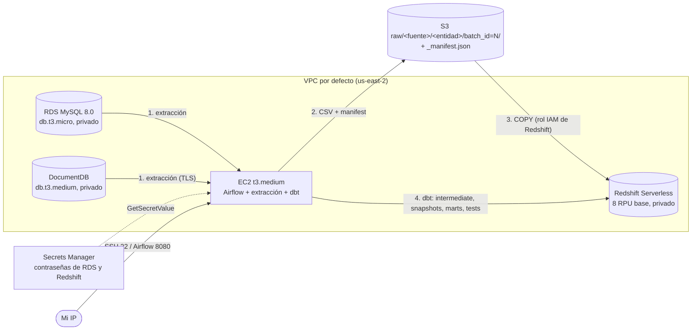

# Arquitectura

## Flujo de un lote (DAG `ecommerce_pipeline`)
`validate_environment` → `resolve_batch_id` → `extract_to_s3` → `load_to_redshift` → `dbt_deps` → `dbt_seed` → `dbt_run_intermediate` → `dbt_run_quarantine` → `dbt_snapshot` → `dbt_run_marts` → `dbt_test` → `reconcile_batch`

1. **Extracción:** lee MySQL (4 entidades) y DocumentDB (2 colecciones) desde la EC2 y escribe CSV en S3 bajo `raw/<fuente>/<entidad>/batch_id=<id>/`. El `_manifest.json` se escribe al final y marca el lote como completo.
2. **Carga:** `COPY` a `"raw".*` en Redshift, en una transacción por lote, y registro en `"raw".batch_control`.
3. **Transformación:** dbt crea intermediate (válidos y cuarentena), snapshots SCD2 y marts (dimensiones y `fct_sales`).
4. **Reconciliación:** verifica que lo cargado sea igual a válidos más cuarentena.

## Recursos de Terraform (22 con todo habilitado)
| Archivo | Recursos |
|---|---|
| `s3.tf` | Bucket (acceso público bloqueado, versionado, cifrado AES256) |
| `iam.tf` | Rol de Redshift (lee el bucket), rol y perfil de la EC2 (lee/escribe el bucket, lee dos secretos) |
| `rds.tf` | Subnet group e instancia MySQL |
| `docdb.tf` | Subnet group, clúster e instancia |
| `redshift.tf` | Namespace y workgroup |
| `security.tf`, `ec2.tf` | Tres grupos de seguridad, llave SSH, EC2 |
