# Evidencias de ejecución en AWS

Capturas de la ejecución real del pipeline (MySQL + DocumentDB → S3 → Redshift Serverless → dbt, orquestado con Airflow). Cada una lleva una línea de contexto. La infraestructura se destruyó después con `terraform destroy`.

Las capturas del 2 de noviembre son de la primera ejecución (lotes 000–002 a mano); las del 3 de noviembre, de la segunda, con Airflow.

## 1. Fuentes de datos
**01 · Datos sintéticos en MySQL y DocumentDB.** El generador crea 50 clientes, 25 productos, 100 pedidos, 253 líneas, 150 reseñas y 500 eventos, e inyecta filas defectuosas (34). Los conteos finales incluyen esas filas.
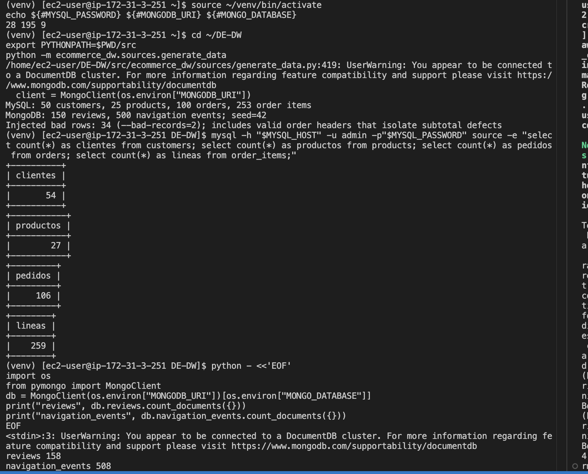

## 2. Extracción a S3
**02 · Zona `raw` en S3.** Un CSV y un `_manifest.json` por fuente, entidad y lote (`batch_id=000`, `001`, `002`).
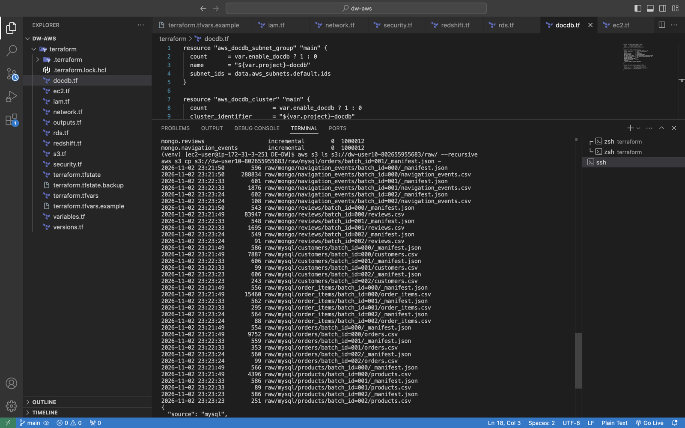

**03 · Contenido de un manifest.** Lote 001 de `orders`: 3 filas, `sha256` del CSV, columnas y marca de agua (`800005` → `1000012`). El manifest se escribe al final y marca el lote como completo.
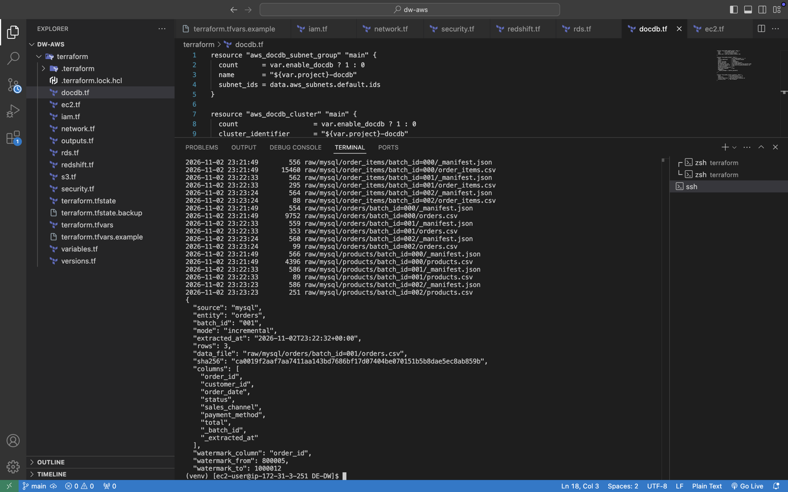

## 3. Carga incremental y SCD2
**04 · Estado de partida en Redshift.** `marts.fct_sales` con 253 filas y `marts.dim_customer` con 50, antes del lote 002.
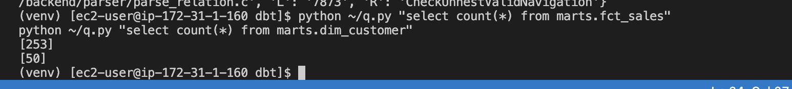

**05 · Cambios en el origen y lote 002.** Se cambia la ciudad del cliente 1 (Bogotá → Medellín) y la categoría del producto 1 (Electrónica → Hogar), y se extrae, carga y transforma el lote 002.
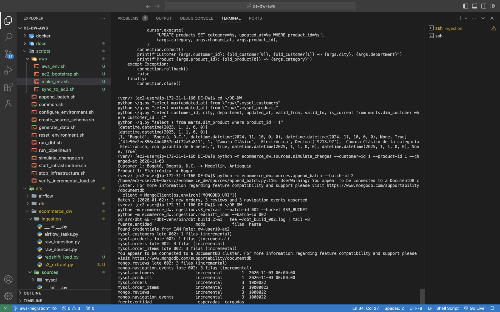

**06 · Resultado del lote 002.** Esperadas = cargadas en las 6 entidades, dbt con 130/130 pruebas en verde y SCD2: el cliente 1 y el producto 1 tienen una fila histórica cerrada y una vigente. `fct_sales` pasa a 259 y `dim_customer` a 51.
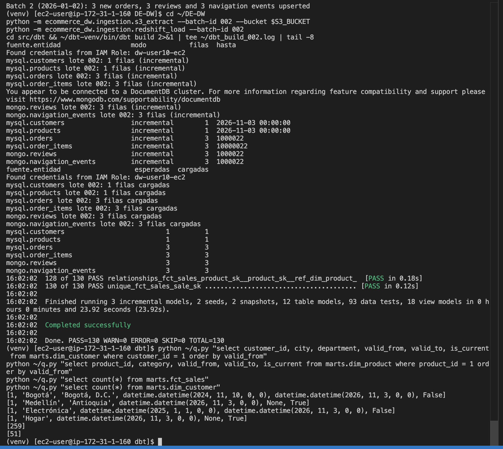

## 4. Orquestación con Airflow
**07 · Resolución del lote.** `resolve_batch_id` detecta que el lote 003 está completo y cargado, y abre el 004.
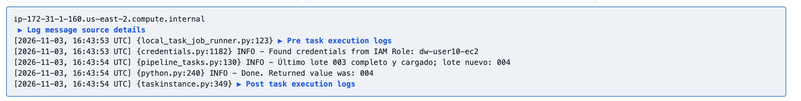

**08 · Reconciliación.** `reconcile_batch` verifica que lo crudo sea igual a válidos más cuarentena por entidad, y que `fct_sales` (259) coincida con las líneas válidas.
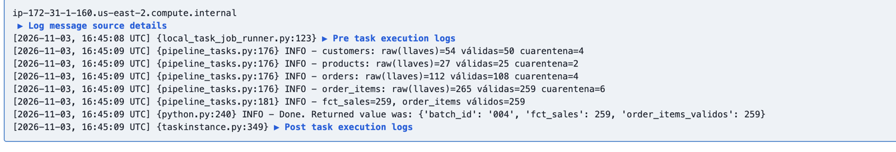

**09 · DAG completo exitoso.** Las 12 tareas de `ecommerce_pipeline` en verde.
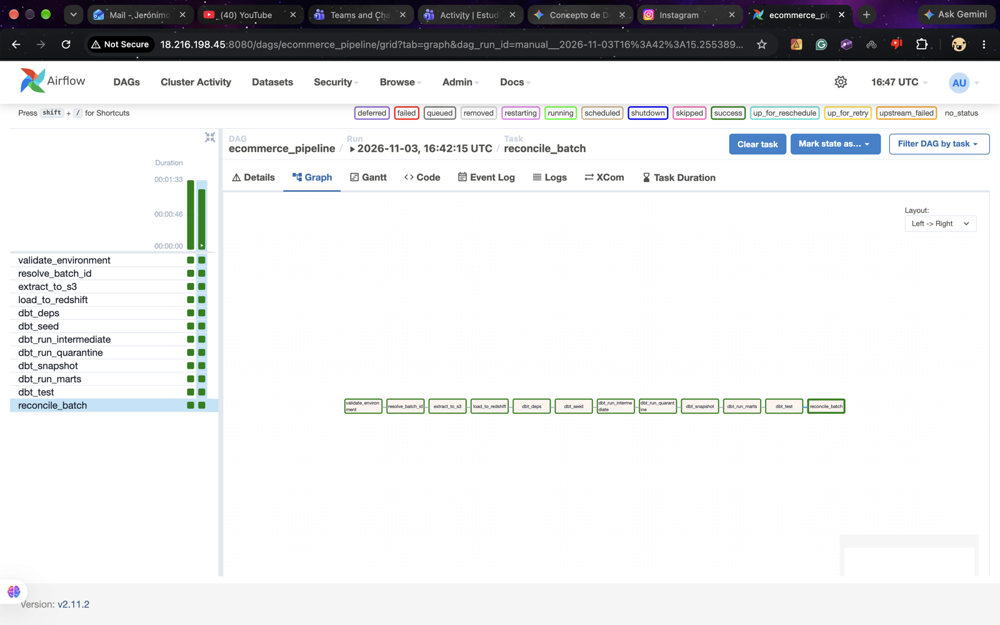

## 5. Fallo y recuperación
**10 · Fallo simulado.** Se activa la variable `simulate_failure`: `load_to_redshift` falla y las tareas siguientes quedan en `upstream_failed`.
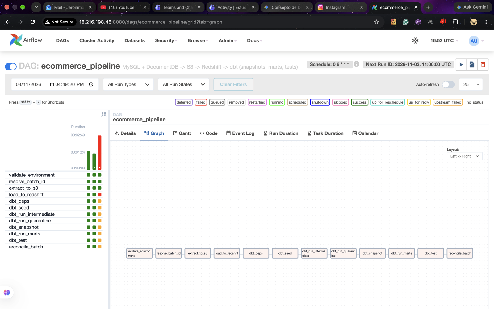

**11 · Detalle del fallo.** La extracción a S3 terminó bien; la carga falló.
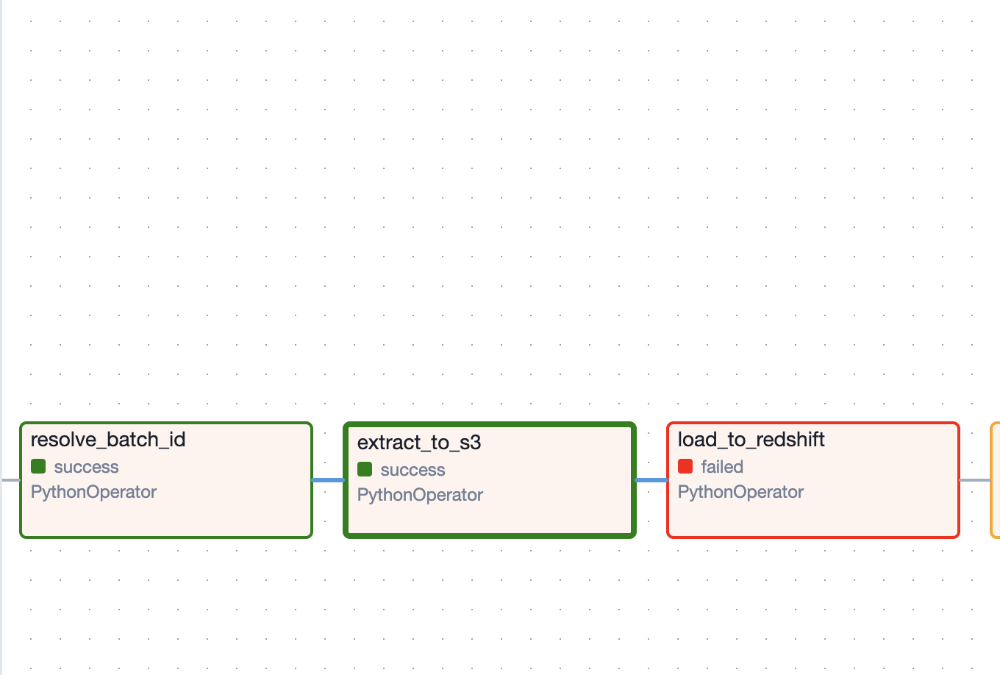

**12 · Reintento exitoso.** Tras limpiar la tarea fallida (Clear), el pipeline continúa desde ahí, reutiliza el mismo lote y termina en verde.
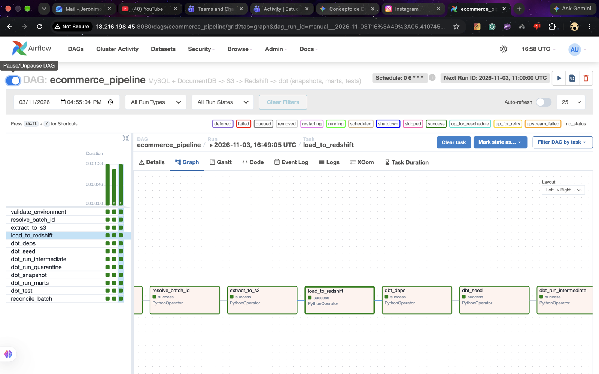

## 6. Marcadores de lote y calidad
**13 · `batch_control` del lote 004.** Las 6 entidades en estado `loaded` (lote sin filas nuevas) y las filas de `order_items` por lote en la capa raw: 000 → 259, 001 → 3, 002 → 3; el lote 004 no duplica nada.
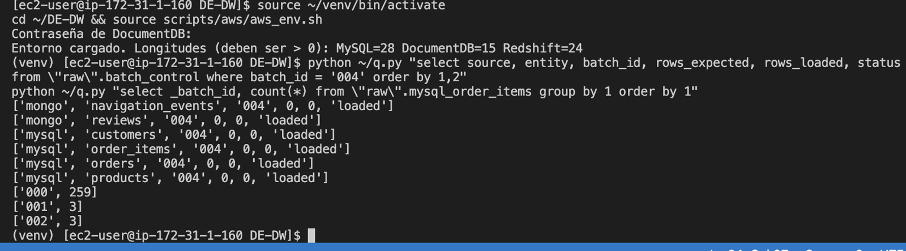

**14 · Cuarentena y cuadre de totales.** Motivos de rechazo por entidad (2 filas de cada uno). `fct_sales` tiene 259 líneas por 7 420 730,58 y el origen 265 por 7 420 800,58: la diferencia son las 6 líneas en cuarentena, que suman 70,00.
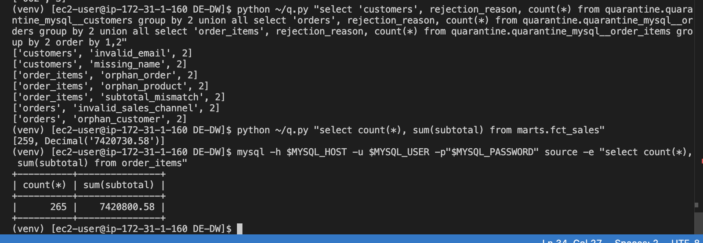

**15 · Lote 005.** Otra ejecución sin cambios: de nuevo 6 entidades en `loaded`, sin duplicar datos.
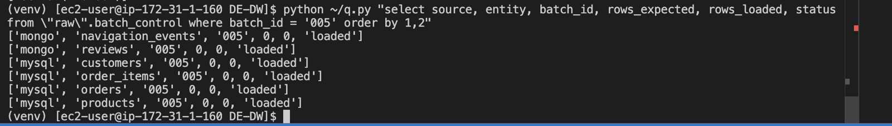
